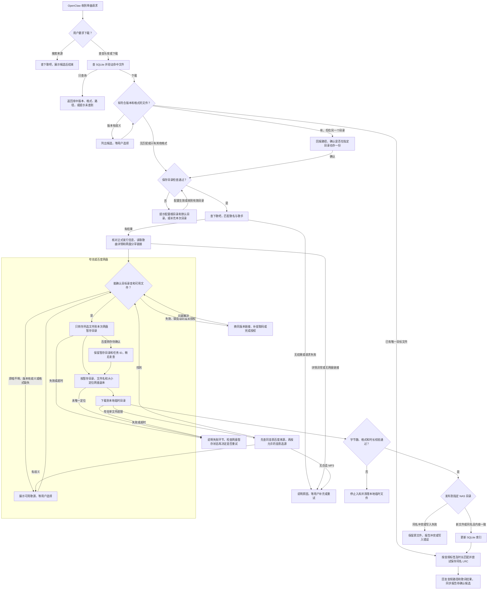

# `music-download` 技能方案

## 使用方式

在 NAS 上的 OpenClaw 聊天里说「《成都》赵雷，你下载一下这一首歌」，技能先查整个 NAS 音乐库的 SQLite 索引。已有符合要求的文件时直接回报路径。仍需下载且歌曲版本能唯一确定时，继续下载并回报入库路径。

- 「把赵雷的《成都》下载到 `/music/华语`」使用本次指定的目录。省略目录时使用技能配置的默认目录。目标目录需要位于配置允许的音乐库根目录，且 OpenClaw 运行环境有写入权限。如果还没配置默认目录，聊天里先询问保存位置。容器部署时，配置填写容器内的挂载路径。
- 同一录音默认按夸克 FLAC → 百度 FLAC → 夸克 MP3 → 百度 MP3 选源。用户只要无损时限于前两项。录音或专辑仍无法唯一确认时进入待确认列表。
- 能用正式发行信息和分享文件核实原唱及录音版本时，选定一个来源直接下载。原唱或录音版本有歧义时，列出候选歌源和可见的歌手、专辑、版本、格式及大小，批量任务先处理其他曲目，结束后集中让用户选择。待确认曲目达到 10 首时暂停任务。
- 「赵雷的《成都》下载过吗」直接查音乐库。首次查询扫描目录建库，之后只查 SQLite 和命中文件。「刷新音乐库索引」重新扫描，纳入手动添加或移动的文件。默认数据库为技能目录下的 `data/library.sqlite3`，可用 `MUSIC_LIBRARY_DB` 改到持久化目录。
- 新下载的音频入库后自动尝试保存同名 `.lrc`。匹配可信度相当时优先使用简体中文歌词。英文歌词沿用原顺序。「给库里赵雷的《成都》补歌词」先确定一个已入库文件，再用 `lyrics` 查询并保存。

单曲和批量下载均以现有 NAS 音乐库为落点。文件名使用 `赵雷 - 成都.flac`，含明确版本名时附上版本。批量下载接收歌名清单，将每首的查库、来源确认、转存和入库进度持久化后继续调度。

## Skill SOP

用户指定目录时优先使用本次目录，省略时使用配置的默认目录。首次缺少配置时以 `/music/华语` 为例引导，路径以 OpenClaw 实际挂载为准。用户回复目录、候选编号或提取码后，沿用本次已确认的歌名、版本、格式和目录。

未指定音质时优先查两家的 FLAC。链接标签未标明格式时查看分享内文件。两家没有可用的 FLAC 时，再查同版本的 MP3。夸克返回的上限用于筛选夸克文件。

### 异常处理

| 情况 | 处理 |
| --- | --- |
| 首次缺配置，或目录无效 | 根目录缺失时提示 `MUSIC_LIBRARY_ROOT`，例如 `/music`。默认目录缺失时提示 `MUSIC_LIBRARY_DEFAULT_DIR`，例如 `/music/华语`，也可询问本次目录。若已有有效的本次目录，可先下载并顺带提醒默认配置。目标路径须在音乐库根目录内。 |
| 索引查询或更新异常 | 查询出错时报告无法确认是否已入库。音频发布成功后索引写入出错，保留音频并报告索引问题，索引恢复后可刷新。 |
| 下歌吧无匹配、详情不可用或接口报错 | 无匹配时提示用户补充歌名、歌手或版本。接口超时、限流或详情读取失败时，报告出错环节，待恢复后可继续查找。 |
| 分享失效、缺少提取码或网盘未授权 | 分享失效时可尝试已确认版本和音质的其他链接。缺提取码时向用户索取。缺授权或过期时，按对应网盘的官方流程授权后继续。 |
| 网盘 CLI 或音频校验工具缺失 | 夸克检查 Node.js 和 `MUSIC_QUARK_CLI`，百度检查官方 `bdpan`，音频校验检查 `ffprobe`。 |
| 转存失败、网盘空间不足、转存后找不到文件或下载超时 | 回报具体环节和已创建的网盘暂存目录。空间不足时先处理容量。超时或未唯一定位时先核对网盘状态，再决定是否重试。网盘中的暂存副本会保留。 |
| 夸克文件超过单文件下载上限 | 先核对百度相同音质。同一录音在两家都无可用 FLAC 且允许降级时，再按夸克、百度的顺序寻找 MP3。保留已有转存信息，报告实际网盘和格式。 |
| 文件大小、音频格式或时长校验失败 | 停在入库前，清理本地临时文件，回报失败原因，必要时换同版本来源。 |
| 同名文件或 NAS 写入失败 | 同名且 SHA-256 相同则返回已有路径。同名不同内容则保留原文件并报告冲突。目标不可写、空间不足或挂载不支持硬链接时，报告具体错误，修复后再继续。 |
| 歌词版本或时间轴有歧义 | 显示来源、歌名、歌手、专辑和时长。用户选择后按候选 ID 续接，原 `.lrc` 和音频保留。 |
| 歌词缺失、限流或写入失败 | 匿名查询依次尝试 LRCLIB、网易云、QQ 和酷狗。歌曲无匹配时间轴时报告未找到。来源暂时不可用或本地写入失败时，保留音频入库结果，后续可单独补查。 |

## 实现位置

- [SKILL.md](../../skills/music-download/SKILL.md) 定义触发条件、默认目录和音质的使用规则、候选交互与结果反馈。
- [执行参考](../../skills/music-download/references/runtime.md) 记录网盘配置、脚本用法和返回状态。
- [批量队列](../../skills/music-download/scripts/music_batch.py) 持久化曲目状态，最多并发执行 10 首。各曲目独立重试 5 次，默认格式缺失时自动降级 MP3。失败、缺少音源及版本歧义可分别查询，待确认达到 10 首时暂停。用户确认后用 `--continue-review` 继续剩余队列，中断后用原批次 ID 核对已记录的转存及发布状态并继续。

## 待验证与验收

已用下歌吧接口验证《成都》的搜索、版本及分享地址返回。已通过本机 Codex 和夸克 CLI 下载赵雷《少女》的 FLAC，完成本地入库并保存同名 LRC。已验证匿名歌词查询、酷狗候选选择、重复调用和查询失败时保留音频。NAS 挂载与写入权限，以及 OpenClaw 聊天中的完整交互，留待端到端验证。

- 使用一首有权下载的曲目，从聊天指令走通搜索、选曲、转存、下载和入库。实际音频格式与请求一致，文件出现在指定目录，有现成播放器时验证扫描后可播放。
- 验证省略目录时使用默认目录，指定目录时保存到指定位置。遇到版本歧义或明确指定的音质不可用时，用户选择后才继续下载。
- 验证下载前能查到其他目录的同版本同格式音频，并且可以单独查库。手动新增或移动文件后刷新索引，删除的文件不再作为有效命中。
- 重复请求同一文件时返回已有路径。同名不同内容、分享失效或下载中断时，音乐库里的原文件保持完整，且目录内没有可被识别为成品的残缺音频。
